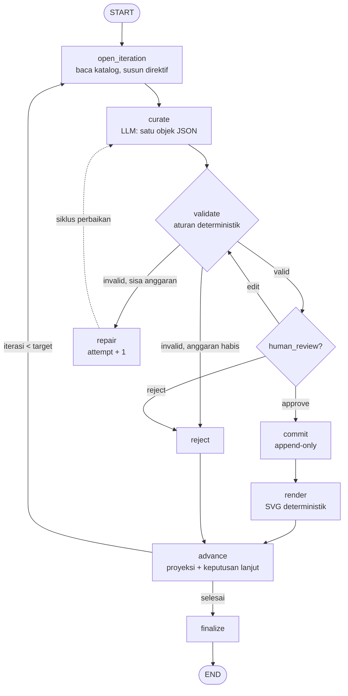

# Museum Peradaban yang Tidak Pernah Ada

Satu agen kurator. Satu katalog. Satu artefak baru per iterasi.

Setiap iterasi agen membaca **seluruh** katalog yang pernah ia buat, lalu menambahkan
**tepat satu** artefak yang konsisten dengan sejarah materialnya sendiri: bahan, motif,
garis keturunan, kronologi, dan rujukan silang ke karya lama. Ini bukan proyek generate
teks atau gambar — ini eksperimen **memori akumulatif dan koherensi dunia lintas iterasi**
di dalam satu agen, satu loop, satu state.

Dibangun di atas **LangGraph**: `StateGraph`, node terpisah, **conditional routing**,
**dua siklus eksplisit**, dan **persistence lewat `SqliteSaver`** dengan `thread_id` tetap.
LLM hanya mengusulkan satu objek JSON; kode deterministik memegang fakta, validasi,
penyimpanan, dan rendering.

| | |
|---|---|
| 20 iterasi mock | 24 artefak (4 seed + 20), 6 garis keturunan, 13 bahan, 10 motif |
| Rentang tahun fiktif | 212 – 507 |
| Waktu jalan | ±0,48 detik untuk 20 iterasi (mock), ±24 ms/iterasi |
| Katalog valid | id unik, semua `refs` ada, tahun tidak mundur, kosakata terkontrol |
| Plakat visual | SVG prosedural deterministik, tanpa model gambar |
| Katalog | mobile-first (bottom sheet, layar penuh, tombol back perangkat) + ekspor statis 61 berkas untuk Netlify |

---

## 1. Rencana eksekusi

1. **Domain lebih dulu, LLM belakangan.** Tetapkan kosakata terkontrol (bahan, motif,
   form, fungsi, lineage, palet), skema artefak, dan aturan dunia. LLM hanya memilih
   di dalam ruang yang sudah tertutup itu.
2. **Siklus kurasi sebagai graf**, bukan `while` di dalam node: `open_iteration → curate →
   validate → (repair ↺ curate) → commit → render → advance → (ulang | finalize)`.
3. **Pisahkan "mengusulkan" dari "menulis".** Node `curate` tanpa efek samping;
   `validate` murni; hanya `commit` yang menyentuh katalog, dan katalog memakai reducer
   `operator.add` sehingga satu-satunya update yang mungkin adalah *append*.
4. **Checkpoint sebagai sumber kebenaran**, proyeksi berkas sebagai turunan yang bisa
   dibangun ulang (`catalog.json`, `ledger.jsonl`, `renders/*.svg`).
5. **Seed empat artefak fondasi** agar rujukan silang punya sasaran sejak iterasi pertama.
6. **Buktikan dengan tes**: 20 iterasi mock, penolakan dengan nol tulisan parsial,
   determinisme render, resume setelah proses mati, dan interrupt human-in-the-loop.
7. **Katalog dibaca di mana saja.** Satu UI mobile-first untuk `museum serve`, lalu
   katalog yang sama dibekukan jadi `dist/` statis agar bisa hidup di Netlify tanpa
   server, tanpa SQLite, dan tanpa kunci API.

---

## 2. Menjalankan (60 detik)

Prasyarat: Python ≥ 3.11.

```bash
cd projects/museum-of-unlived-civilizations
make install              # venv + pip install -e ".[dev]"

make seed                 # deposit fondasi: 4 artefak
make run ITERATIONS=20    # 20 siklus kurasi dengan mock
make verify               # periksa seluruh invarian katalog
make acceptance           # buktikan 7 kriteria sukses di state sementara
make serve                # katalog web di http://localhost:8000
make export               # situs statis siap Netlify di dist/
```

Atau tanpa `make`:

```bash
python3 -m venv .venv && .venv/bin/pip install -e ".[dev]"
.venv/bin/museum seed --root museum-state
.venv/bin/museum run  --root museum-state --iterations 20
.venv/bin/museum serve --root museum-state --port 8000
```

Perintah lain:

```bash
museum status                  # ringkasan state + pemeriksaan integritas
museum history --limit 20      # checkpoint (time travel)
museum graph                   # graf kurasi sebagai mermaid
museum render                  # render ulang semua plakat
museum rebuild                 # bangun ulang proyeksi + render dari checkpoint
museum export --out dist       # ekspor situs statis (tanpa server, tanpa SQLite)
museum reset --yes             # hapus seluruh state museum
```

---

## 3. Bentuk graf



### Node: apa, dan mengapa dipisah

| Node | Jenis | Tanggung jawab | Alasan tidak digabung |
|---|---|---|---|
| `open_iteration` | deterministik | Baca seluruh katalog, hitung ledger, pilih **direktif** (kelanjutan / pemulihan / persilangan / monumen / patahan), set `attempt = 0` | Ritme sejarah harus deterministik dan bisa diuji tanpa LLM. Node ini adalah "brief" kurator. |
| `curate` | **satu-satunya** panggilan LLM | Minta tepat satu JSON artefak, parse dengan toleran | Tanpa efek samping ⇒ aman di-retry (`RetryPolicy`), aman di-replay, dan mudah diganti mock ↔ API. |
| `validate` | murni | Skema + seluruh aturan dunia | Murni ⇒ bisa dipanggil berkali-kali tanpa efek. Memisahkannya adalah syarat agar **edge perbaikan** bisa dinyatakan di graf, bukan di `while` dalam node. |
| `repair` | deterministik | Naikkan `attempt`, teruskan umpan balik pelanggaran | Anggaran perbaikan milik graf; node ini membuat transisi `invalid → curate` eksplisit dan terlihat di checkpoint. |
| `human_review` | `interrupt` | Berhenti, tunggu keputusan manusia | Opsional, default mati (lihat §6). |
| `commit` | satu-satunya penulis katalog | Validasi ulang, stempel `iteration`/`created_at`/digest, append lewat reducer | "Defence in depth": keputusan validasi lama tidak dipercaya buta. Atomik: satu artefak per commit. |
| `render` | murni + tulis berkas | SVG deterministik dari JSON | Efek samping dipisah dari commit, sehingga kegagalan renderer tidak bisa menghilangkan aksesi, dan bisa di-replay. |
| `reject` | deterministik | Catat penolakan (draf, kode, percobaan) tanpa menyentuh katalog | Kegagalan adalah bagian dari sejarah museum dan harus terekam, bukan ditelan. |
| `advance` | deterministik | Tulis proyeksi, hitung statistik, putuskan lanjut/berhenti | Titik tunggal tempat satu iterasi "ditutup" dan satu-satunya tempat siklus luar diputuskan. |
| `finalize` | deterministik | Proyeksi final + status `complete` | Menandai akhir run tanpa mengubah domain. |

Tidak ada node "super" yang menggabungkan generate + validate + commit. Kalau digabung,
kita kehilangan tiga hal sekaligus: jejak per langkah di checkpoint, kemampuan
memisahkan penyebab kegagalan (model vs aturan), dan kemungkinan menyatakan retry
sebagai edge graf.

### Di mana siklusnya

Ada **dua siklus**, keduanya edge eksplisit:

1. **Siklus perbaikan** (intra-iterasi): `validate --(invalid, attempt < max)--> repair --> curate`.
   Anggaran `max_attempts` (default 3) dijaga `after_validation`. Bila habis:
   `validate --> reject`, dan iterasi tetap dihitung (museum boleh menolak menambah koleksi).
2. **Siklus kurasi** (antar-iterasi): `advance --(iteration < target)--> open_iteration`.
   `target_iterations` adalah satu-satunya tombol berhenti; `advance` membacanya dan
   memutuskan `continue` atau `finish`. Tidak ada `while` di dalam node mana pun.

Karena siklus dinyatakan sebagai edge, satu `invoke` bisa menjalankan N iterasi, dan
setiap node perantara punya checkpoint. `recursion_limit` dihitung dari sisa target
(`max(200, 40 + 20 × sisa_iterasi)`), jadi graf tidak mati di tengah jalan.

### Conditional routing

Tiga fungsi routing murni, semuanya hanya membaca state:

- `after_validation`: `human_review` / `commit` / `repair` / `reject`.
- `after_review`: `commit` / `validate` (hasil edit manusia divalidasi ulang) / `reject`.
- `after_advance`: `continue` / `finish`.

---

## 4. State, dan mengapa katalog aman

`MuseumState` (TypedDict) memisahkan tiga hal:

| Kelompok | Field | Sifat |
|---|---|---|
| Eksekusi | `iteration`, `target_iterations`, `attempt`, `max_attempts`, `status`, `halt_reason` | ditimpa tiap langkah |
| Memori kerja | `brief`, `pending_draft`, `validation`, `repair_feedback`, `review_decision`, `review_approved`, `last_committed`, `stats` | ditimpa tiap iterasi |
| Domain | `catalog`, `rejections`, `renders`, `timeline`, `log` | **append-only** lewat `Annotated[list, operator.add]` |

Keputusan penting:

- **Katalog disimpan sebagai list of dict (JSON), bukan objek Pydantic.** Checkpoint jadi
  portabel dan terbaca mesin lain; model `Artifact` (frozen) direkonstruksi saat
  validasi/commit/render. Artefak yang sudah masuk tidak bisa diubah: `Artifact` memakai
  `ConfigDict(frozen=True)`, dan reducer hanya bisa menambah.
- **Brief ringkas, konteks dibangun ulang.** `brief` (direktif + catatan) disimpan;
  konteks panjang untuk prompt (ledger, registry, kosakata) dibangun ulang di `curate`
  dari katalog. Ini memotong ukuran checkpoint tanpa kehilangan apa pun yang tidak bisa
  diturunkan ulang.
- **Reinterpretasi hanya lewat `refs`.** Tidak ada jalur kode yang menulis ke artefak lama.

---

## 5. Persistence: checkpoint vs proyeksi

```python
SqliteSaver(sqlite3.connect("museum-state/checkpoints.sqlite"))
graph = build_graph(deps, checkpointer=saver).compile()
graph.invoke(..., {"configurable": {"thread_id": "museum-main"}}, durability="sync")
```

- **`thread_id` tetap** (`museum-main`) membuat iterasi berikutnya melanjutkan state yang
  sama, bukan memulai museum baru. `--thread` memungkinkan beberapa "pameran" paralel
  dengan katalog masing-masing.
- **`durability="sync"`** menulis checkpoint di setiap super-step. Kalau proses mati di
  tengah iterasi, eksekusi melanjutkan dari node terakhir yang selesai; draf yang belum
  lolos validasi tidak pernah masuk katalog.

**Domain state vs execution state.** Keduanya hidup di checkpoint yang sama, tetapi
konsekuensinya berbeda dan sengaja dipisahkan secara konseptual:

| | Domain (katalog) | Eksekusi (checkpoint) |
|---|---|---|
| Isi | artefak, penolakan, timeline | posisi node, attempt, draf, `next` |
| Sumber kebenaran | checkpoint | checkpoint |
| Turunan | `catalog.json`, `ledger.jsonl`, `renders/` | `museum history` |
| Kalau hilang | fatal (kecuali proyeksi + ledger masih ada) | run diulang |

Konsekuensi praktis:

- **Replay**: katalog bisa diproyeksikan ulang kapan saja (`museum rebuild`). Render
  deterministik berarti SVG yang dihapus bisa diregenerasi byte-identik.
- **Fault tolerance**: tes `test_state_survives_process_restart` menjalankan 5 iterasi,
  menutup museum, membuka instance baru pada SQLite yang sama, lalu melanjutkan ke 8
  iterasi tanpa kehilangan satu artefak pun. Interrupt HITL juga bertahan melewati restart.
  Percobaan `SIGKILL` manual (LLM lambat 2,5 detik/iterasi, proses dibunuh di tengah
  iterasi 2) menyisakan `next = ("curate",)`, 5 artefak, dan `verify` bersih; setelah
  `museum run --iterations 2` museum melanjutkan ke iterasi 4 dengan 7 artefak — tanpa
  duplikat dan tanpa artefak yatim.
- **Ledger idempoten**: commit menulis `ledger.jsonl` lebih dulu, lalu checkpoint. Kalau
  proses mati di antara keduanya, commit yang diulang menemukan id yang sudah ada dan
  tidak menulis ganda; `museum rebuild` menyusun ulang ledger dari checkpoint bila
  keduanya sempat berbeda.
- **Time travel**: `museum history` menampilkan rantai checkpoint (`next`, status, jumlah
  artefak, draf yang tertunda). Forking ke masa lalu secara teknis mungkin di lapisan
  eksekusi (`update_state`), tetapi **sengaja tidak diekspos untuk mengedit artefak**:
  masa lalu domain bersifat immutable. Time travel di sini untuk audit, bukan revisi.
- **Biaya**: setiap checkpoint menyimpan snapshot state. Untuk 24 artefak: 139 checkpoint,
  ±4,6 MB SQLite, `catalog.json` 50 kB, 695 kB SVG. Ini O(n²) terhadap panjang katalog.
  Mitigasi yang dipakai: brief ringkas, `raw` keluaran LLM dipotong 2 kB, thread pendek
  per musim pameran, dan proyeksi yang bisa dibangun ulang. *Tidak* dipakai: prune
  otomatis (`SqliteSaver.prune` belum tersedia di versi ini) dan penyimpanan katalog di
  luar state — keduanya akan mengorbankan atomisitas append + time travel.

**Kenapa tidak katalog di database terpisah dengan state hanya berisi referensi?**
Itu akan mengecilkan checkpoint, tetapi memindahkan sumber kebenaran keluar dari
LangGraph, memaksa dua fase commit (state + DB) yang bisa tidak konsisten, dan
menghilangkan kemampuan replay satu iterasi dari checkpoint. Untuk skala pameran
(10²–10³ artefak) snapshot penuh masih wajar; untuk skala lebih besar desainnya perlu
event-log di luar graf. Trade-off ini dicatat, bukan disembunyikan.

Proyeksi (dibaca web, mudah di-diff, tidak butuh SQLite):

```text
museum-state/
├── checkpoints.sqlite     # sumber kebenaran (state domain + eksekusi)
├── data/catalog.json      # proyeksi untuk katalog web
├── data/ledger.jsonl      # log commit append-only (id, digest, artefak)
├── data/meta.json         # ringkasan iterasi/status
└── renders/<id>.svg       # plakat deterministik
```

---

## 6. Human-in-the-loop: opsional, dan kenapa

Default museum berjalan **otonom** (tanpa interrupt), sesuai misi "satu agen". Namun
`--review` mengaktifkan node `human_review`, yang memanggil `interrupt(payload)`
berisi draf, hasil validasi, dan direktif. Tiga keputusan:

```bash
museum run --review --iterations 1          # berhenti di interrupt
museum review                               # lihat draf yang menunggu
museum review --decision approve
museum review --decision reject --note "terlalu mirip karrun-topeng-mata"
museum review --decision edit --file draf.json
```

- `approve` → `commit`.
- `reject` → `reject` (tanpa tulisan).
- `edit` → hasil edit **divalidasi ulang** oleh `validate`; kalau melanggar aturan,
  museum menolak (bukan memaksa masuk). Ini menjaga manusia tetap tunduk pada hukum dunia.

Kenapa tetap opsional: misi menuntut otonomi dan koherensi lintas iterasi; interrupt
mengubah sifat eksperimen dari "kurator tunggal" menjadi "kurator + editor". Interrupt
disiapkan karena ia memperlihatkan bagian penting dari model mental LangGraph
(pause/resume dengan state yang sama), dan bisa dinyalakan tanpa mengubah kode.

---

## 7. Kontrak artefak & aturan dunia

Contoh (dipotong):

```json
{
  "id": "karrun-tenun-tanda",
  "title": "Tenun Tanda dari Gudang Garam",
  "year_fictional": 331,
  "lineage": "karrun",
  "form": "tenun",
  "function": "kronik",
  "materials": ["obsidian", "tulang-paus", "serat-pandan"],
  "motifs": ["mata-ganda"],
  "refs": [
    {"id": "karrun-topeng-mata", "relation": "turunan",
     "note": "Membawa obsidian dari Topeng Mata Ganda (301); teknik parutnya diulang lalu dibelokkan"},
    {"id": "savra-guci-parut", "relation": "kutipan",
     "note": "Mengutip larangan menyebut nama dari Guci Parut Tujuh tanpa memakai bahannya"}
  ],
  "inscription": "Dipahat sembilan kali, ditolak tujuh kali; yang tersisa hanya kesaksian yang tidak bisa dibohongi.",
  "provenance_note": "Masuk katalog lewat jalur monumen ...",
  "visual": {"form": "tenun", "palette": "arang", "motif": "mata-ganda",
             "symmetry": "radial", "density": 0.7, "strata": 6}
}
```

Aturan ditegakkan dua lapis: **skema** (Pydantic: tipe, panjang, pola id, rentang,
`extra="forbid"`) dan **semantik** (validator). Semua pelanggaran dikembalikan sebagai
kode, bukan exception — model yang salah tidak boleh menjatuhkan museum.

| Kode | Arti |
|---|---|
| `SCHEMA` | bentuk JSON salah (tipe, field asing, rentang, pola id) |
| `ID_DUPLICATE`, `TITLE_DUPLICATE` | id/judul sudah dipakai |
| `YEAR_REGRESSION` | tahun lebih kecil dari tahun terakhir katalog |
| `YEAR_JUMP` | lompatan > 120 tahun (menjaga kronologi tetap terbaca) |
| `MATERIAL_UNKNOWN`, `MOTIF_UNKNOWN`, `FORM_UNKNOWN`, `FUNCTION_UNKNOWN`, `LINEAGE_UNKNOWN`, `PALETTE_UNKNOWN`, `SYMMETRY_UNKNOWN`, `RELATION_UNKNOWN` | id di luar kosakata terkontrol |
| `DUPLICATE_ENTRY` | bahan/motif berulang dalam satu artefak |
| `LINEAGE_MATERIAL_MISMATCH` | tidak ada bahan khas garis keturunannya |
| `REFS_EMPTY` | artefak baru tidak merujuk apa pun padahal katalog sudah ada |
| `REF_MISSING`, `REF_SELF`, `REF_DUPLICATE`, `REF_FUTURE` | rujukan tidak ada / ke diri sendiri / berulang / ke karya yang lebih muda |
| `REF_UNJUSTIFIED_MATERIAL` | relasi `turunan`/`pemulihan` tidak membawa bahan dari artefak yang dirujuk |
| `REF_UNJUSTIFIED_MOTIF` | relasi `resonansi` tidak berbagi motif |
| `REF_NOTE_GENERIC` | catatan rujukan disalin mentah-mentah |
| `NEW_LINEAGE_UNDERJUSTIFIED` | lineage baru tidak menyitir minimal dua karya lama |
| `VISUAL_FORM_MISMATCH`, `VISUAL_MOTIF_MISMATCH` | parameter visual tidak menggambarkan artefak ini |

`verify_catalog()` membaca ulang invarian yang sama secara global (termasuk
`REF_NOT_PRIOR`: rujukan ke artefak yang belum lahir) — dipakai `museum verify` dan tes,
sebagai bacaan kedua yang independen dari validator per-draf.

**Kenapa aturan ini?** Karena koherensi dunia bukan hasil "prompt yang bagus", tetapi
hasil batasan yang tidak bisa dilanggar: sejarah yang tidak bisa mundur, bahan yang tidak
bisa muncul dari ketiadaan, dan setiap interpretasi masa lalu wajib menyebut karyanya.

---

## 8. Kosakata terkontrol & direktif kurasi

Kosakata hidup di `vocabulary.py` dan tidak pernah diubah oleh LLM:

| Kategori | Isi |
|---|---|
| Lineage (6) | `savra`, `ulmen`, `karrun`, `heska`, `oroba`, `tirsa` — masing-masing punya lanskap, temperamen, bahan & motif khas |
| Bahan (14) | `kapur-putih`, `serat-pandan`, `kayu-cendana`, `perunggu-timah`, `obsidian`, `tulang-paus`, `kaca-vulkanik`, `tembaga-hijau`, `tanah-liat`, `resin-jernih`, `gipsum-berlapis`, `benang-perak`, `batu-sungai`, `garam-kristal` |
| Motif (10) | `spiral-terbuka`, `tangga-langit`, `mata-ganda`, `jala-bintang`, `parut-tujuh`, `cincin-berputar`, `akar-terbalik`, `gelombang-diam`, `bara-pecah`, `simpul-tiga` |
| Form (10) | `guci`, `lempeng`, `topeng`, `tenun`, `alat-musik`, `relikuari`, `monolit`, `cincin`, `lampu`, `arca` |
| Fungsi (10) | `ritual`, `arsip`, `penanda-makam`, `alat-ukur`, `hiburan`, `perdagangan`, `penjaga-ambang`, `kronik`, `persembahan`, `perlindungan` |
| Relasi (5) | `turunan`, `pemulihan`, `resonansi`, `kutipan`, `patahan` |
| Palet (6) | `garam`, `kabut`, `arang`, `kaca`, `rawa`, `puncak` — warna dipakai renderer |

**Direktif** adalah pacing deterministik yang dihitung dari data katalog: siklus lima
irama `kelanjutan → pemulihan → persilangan → monumen → patahan`, dengan fallback bila
tidak memenuhi syarat (mis. `pemulihan` butuh bahan yang benar-benar sudah lama tidur;
`patahan` butuh lineage yang belum pernah lahir). Hasil nyata pada 20 iterasi:
5 kelanjutan, 3 pemulihan, 5 persilangan, 4 monumen, 3 patahan.

Direktif juga mengusulkan kandidat rujukan (karya terakhir, pengguna bahan yang dorman,
leluhur paling sering dikutip), jendela tahun (6–40 tahun ke depan), dan gaya lineage
(lanskap + temperamen). **Kode menentukan irama; LLM menentukan isi.** Inilah yang
mencegah 20 artefak menjadi 20 benda acak.

Contoh arah yang muncul dari aturan ini: `karrun-topeng-mata` dikutip 9 kali, sementara
`ulmen-alat-musik-gelombang` hanya sekali dan `savra` makin jarang — pola yang tidak
pernah diperintahkan secara eksplisit, tetapi muncul dari ledger + direktif.

---

## 9. Renderer deterministik

Tidak ada image generation, tidak ada jaringan, tidak ada state global `random`. Satu
artefak → satu SVG, byte-identik setiap kali (diuji).

```python
render_svg(artifact)          # -> str
render_to_file(artifact, dir) # tulis atomik (.tmp -> replace)
```

Tata bahasa visual:

- **Latar & strata**: palet artefak; `visual.strata` band horizontal bernomor `L01…L09`
  seperti lapisan galian.
- **Siluet**: dari `form` (guci, lempeng, topeng, arca, tenun, alat musik, relikuari,
  monolit, cincin, lampu). Ada plinth dan tanda registrasi seperti pelat arsip.
- **Tesselasi motif**: dari `motif` + `symmetry` (`mirror-x`, `radial`, `translation`,
  `spiral`) + `density`. Sel-selnya "aus": sebagian hilang, masing-masing diputar dan
  diskalakan oleh PRNG yang di-seed dari hash artefak.
- **Tekstur bahan**: garis diagonal halus di dalam siluet + grain deterministik.
- **Aksesi**: id dan tahun di band bawah, motif/palet/siluet di band atas.

Determinisme dijamin karena seed = `sha256(id | visual | iteration)`, dan tidak ada
`datetime.now()` di dalam renderer. Efeknya: `render` boleh dijalankan ulang kapan saja,
di mesin mana pun, dan hasilnya sama; `renders/` bisa dihapus tanpa kehilangan apa pun.

---

## 10. Katalog web

```bash
museum serve --root museum-state --port 8000
# http://localhost:8000
```

Server hanya **membaca proyeksi** (tidak pernah membuka SQLite saat kurator menulis):

| Route | Isi |
|---|---|
| `/` | katalog: rail statistik + filter lineage/bahan, peta rujukan silang, timeline kronologis |
| `/api/catalog` | proyeksi penuh (artefak + graf + statistik) |
| `/api/artifacts/{id}` | artefak + rujukan keluar (dengan target ter-resolve) + "dikutip oleh" |
| `/api/artifacts/{id}/svg` | plakat SVG (di-render malas bila belum ada) |
| `/api/status`, `/api/graph`, `/api/meta` | ringkasan, graf rujukan, metadata |
| `/healthz` | health check |

UI (vanilla JS, tanpa build step): timeline vertikal dengan tahun besar dan plakat;
detail drawer berisi inskripsi, asal-usul, rujukan keluar/masuk yang bisa diklik, dan
parameter visual; peta rujukan silang (x = tahun, y = lineage, warna garis = relasi);
filter lineage/bahan; polling 6 detik agar katalog ikut hidup saat scheduler berjalan.

### 10.1 Di ponsel

Tata letak **mobile-first**, bukan desktop yang dikecilkan. Di bawah 900px:

- rail berubah jadi header ringkas (segel, judul, iterasi) dengan ledger 2 kolom;
- filter pindah ke **bottom sheet** yang dipanggil dock bawah (selalu dalam jangkauan
  ibu jari), lengkap dengan scrim, tombol tutup, `aria-expanded`, dan badge jumlah
  filter aktif; `Escape` menutupnya;
- timeline satu kolom: tahun → plakat 82px → judul, inskripsi (dipangkas 3 baris),
  tag lineage/form/fungsi/rujukan;
- peta rujukan bisa **digeser horizontal** (lebar minimum 620px) dengan node yang punya
  lingkaran sentuh tak terlihat r=12, bukan titik 3,4px;
- detail jadi **layar penuh** (bukan panel samping), dengan tombol tutup 44×44 dan
  `aria-modal`; fokus dikembalikan ke entri asal saat ditutup.

Keputusan khusus ponsel:

- **Tombol back perangkat menutup detail.** Membuka detail melakukan `pushState` ke
  `#/artefak/<id>`, jadi `popstate` menutup sheet, bukan meninggalkan halaman. Deep link
  langsung ke satu artefak tidak menambah entri history, sehingga tombol tutup tidak
  melempar pengguna keluar situs.
- `body { overflow: hidden }` selama sheet/sheet-filter terbuka, ditambah
  `overscroll-behavior: contain` supaya scroll tidak "bocor" ke halaman di belakang.
- `viewport-fit=cover` + `env(safe-area-inset-*)` untuk notch dan home indicator.
- Target sentuh ≥ 36–46px; tidak ada afordansi yang hanya muncul saat hover
  (`@media (hover: hover)`), dan label node peta disembunyikan di perangkat sentuh.
- `prefers-reduced-motion` mematikan transisi dan smooth scroll; efek grain dimatikan di
  ponsel demi biaya compositing.

### 10.2 Ekspor statis untuk Netlify

Netlify tidak menjalankan FastAPI/SQLite, jadi katalog bisa dibekukan menjadi berkas:

```bash
make export                                  # = museum export --root museum-state --out dist
make static STATIC_PORT=8090                 # sajikan dist/ tanpa museum sama sekali
```

`museum export` menyegarkan proyeksi dari checkpoint lebih dulu, lalu menulis:

```text
dist/
├── index.html                  # template yang sama; window.MUSEUM_CONFIG = mode "static"
├── assets/{style.css,app.js,icon.svg}
├── data/catalog.json           # padanan GET /api/catalog
├── data/artefak/<id>.json      # padanan GET /api/artifacts/{id}
├── data/graph.json
├── renders/<id>.svg            # plakat deterministik
├── manifest.webmanifest, 404.html, robots.txt
├── _headers, netlify.toml      # cache + header keamanan
├── BACA-INI.md                 # instruksi unggah di dalam folder
└── .museum-export              # penanda: aman ditimpa saat ekspor berikutnya
```

`app.js` punya dua mode data yang dipilih lewat `window.MUSEUM_CONFIG`:

| Mode | Sumber | Polling |
|---|---|---|
| `api` (default, `museum serve`) | `/api/catalog`, `/api/artifacts/{id}` | 6 detik |
| `static` (hasil ekspor) | `./data/catalog.json` + `./renders/*.svg` | tidak ada |

Mode statis menyusun rujukan keluar/masuk dari katalog yang sudah dimuat, jadi membuka
detail **tidak menambah satu pun permintaan jaringan** (diverifikasi: satu fetch total
untuk seluruh sesi). Navigasi memakai hash, jadi tidak perlu aturan rewrite di hosting.

Cara unggah:

```bash
# 1) paling cepat: seret folder dist/ ke https://app.netlify.com/drop
# 2) Netlify CLI
npm i -g netlify-cli
netlify deploy --dir=dist --prod
# 3) hosting statis apa pun (GitHub Pages, Cloudflare Pages, S3, nginx)
python3 -m http.server -d dist 8090
```

Yang sengaja **tidak** dibawa ke versi statis: scheduler, checkpoint, HITL `museum
review`, dan tombol yang butuh tulis. Versi statis adalah bacaan beku dari satu titik
waktu — sama seperti katalog cetak di lobi museum.

---

## 11. Scheduler & pemulihan

```bash
# iterasi otomatis tiap 30 detik, batas 24 iterasi
museum serve --root museum-state --schedule 30 --iterations 24

# tanpa web server
museum run --root museum-state --interval 10 --iterations 12
```

- Setiap tick = **satu `invoke` graf yang terpisah**, jadi berhenti di antara tick tidak
  kehilangan apa pun.
- Di dalam tick, checkpoint ditulis sinkron per node. `SIGINT`/`SIGTERM`/crash di tengah
  iterasi: lanjutkan dengan `museum run --iterations 1` (state melanjutkan dari node
  terakhir; draf yang belum valid tidak masuk katalog).
- **Satu penulis** dijaga lock file (`scheduler.lock` berisi PID; lock basi dideteksi).
  Proses kedua ditolak, bukan saling menimpa.
- Kesalahan per tick dicatat, scheduler tetap hidup dan mencoba lagi tick berikutnya.

---

## 12. Mock dan LLM sungguhan

### Mock (default)

`MockCurator` menerima konteks yang sama dengan model sungguhan dan mengembalikan string
JSON yang sama bentuknya. Ia bukan jalan pintas: keluaran dipakai untuk menguji validator,
edge perbaikan, dan siklus penuh.

```bash
museum run --chaos off        # selalu valid
museum run --chaos sometimes  # default: iterasi kelipatan 4 gagal di percobaan pertama
museum run --chaos always     # selalu melanggar -> menguji jalur reject
```

Mode `sometimes` sengaja merusak draf dengan empat cara bergiliran: id duplikat, rujukan
hantu, tahun mundur, bahan di luar kosakata. Hasilnya, 20 iterasi tetap menghasilkan 20
artefak valid, **dan** jalur perbaikan benar-benar terpakai (`attempt > 0`).

### LLM API sungguhan

Tidak ada dependensi SDK: adapter memakai `urllib` ke endpoint OpenAI-compatible
(OpenAI, OpenRouter, vLLM, Ollama, dsb).

```bash
export MUSEUM_LLM=openai:gpt-4.1-mini
export MUSEUM_LLM_BASE_URL=https://api.openai.com/v1
export MUSEUM_LLM_API_KEY=sk-...
museum run --root museum-state --llm openai:gpt-4.1-mini --iterations 5
```

Prompt (`prompts.py`) berisi persona kurator, hukum museum, skema JSON lengkap, direktif,
ledger bahan/motif, daftar lineage, registry semua artefak, dan umpan balik penolakan
sebelumnya. `response_format={"type":"json_object"}` dipakai bila didukung; parser tetap
toleran terhadap pagar kode. Transport error di-retry oleh `RetryPolicy(max_attempts=3)`
di node `curate`; kegagalan setelah itu menghentikan run dengan state utuh di checkpoint.
Tidak ada training, tidak ada fine-tuning — model hanya dipanggil.

---

## 13. Seed: deposit fondasi

Empat artefak (iterasi 0, tahun 212–301) membentuk tiga lineage, satu teknik dorman, dan
rujukan pertama:

| Tahun | Artefak | Garis | Peran |
|---|---|---|---|
| 212 | `savra-lempeng-tangga` | savra | akta pertama; tanpa rujukan |
| 240 | `savra-guci-parut` | savra | turunan lempeng (kapur putih) |
| 268 | `ulmen-alat-musik-gelombang` | ulmen | kontak antar-lembah; kutipan + patahan |
| 301 | `karrun-topeng-mata` | karrun | kelahiran lineage baru dari dua karya lama |

Seed **melewati validator yang sama** (`seed_catalog()` gagal keras bila ada pelanggaran),
jadi tidak ada jalur istimewa ke katalog. Ia juga di-render dan dicatat di ledger.

---

## 14. Tes

```bash
make test          # atau: .venv/bin/python -m pytest
```

88 tes di 8 berkas:

| Berkas | Yang dibuktikan |
|---|---|
| `test_validator.py` | 20 kasus: id duplikat, rujukan hilang/diri sendiri, tahun mundur/lompat, bahan/motif/palet/lineage asing, relasi yang tidak membawa bahan/motif, lineage baru tanpa dua leluhur, skema rusak, input sampah — semuanya ditolak tanpa exception dan tanpa mengubah katalog |
| `test_render.py` | determinisme byte, XML valid, semua form × palet × simetri, tanpa `<script>`/`<image>`/URL eksternal, artefak tidak berubah saat dirender, `Artifact` frozen |
| `test_iteration.py` | **20 iterasi mock** (kriteria 1), penolakan tanpa tulisan parsial (kriteria 2), keluaran tak terbaca → reject, resume setelah restart, append-only, time travel, HITL approve + edit-invalid, scheduler + lock, rebuild proyeksi |
| `test_graph.py` | node & edge yang diharapkan, kedua siklus ada dan tidak ada jalan pintas `curate → commit`, reducer katalog, isolasi `thread_id`, interrupt hanya saat `--review` |
| `test_context.py`, `test_mock.py` | direktif selalu merujuk karya yang ada & tidak ke masa depan, siklus lima irama, mock deterministik & patuh direktif |
| `test_web.py` | seluruh endpoint katalog termasuk 404 dan museum kosong, plus kontrak UI mobile (dock, sheet filter, safe-area, reduced motion) |
| `test_export.py` | ekspor statis: 61 berkas lengkap, `index.html` tanpa `/api` absolut, snapshot = checkpoint, detail JSON + SVG per artefak, `cited_by` sama dengan API, ekspor berulang identik, penolakan menimpa direktori asing, museum kosong butuh opt-in, perintah CLI |

---

## 15. Kriteria sukses → bukti

Satu perintah untuk semuanya: **`make acceptance`** menjalankan museum di direktori
sementara, lalu mencetak LULUS/GAGAL untuk ketujuh kriteria di bawah.

| # | Kriteria | Di mana dibuktikan |
|---|---|---|
| 1 | 20 iterasi berurutan dengan mock → katalog valid | `test_twenty_iterations_produce_a_valid_chronology`; `make run ITERATIONS=20` lalu `make verify` |
| 2 | Validator menolak pelanggaran, tanpa state parsial | `test_rejected_draft_writes_nothing`, `test_validator.py` (20 kasus) |
| 3 | Setiap artefak punya visual deterministik | `test_render.py`, `museum-state/renders/*.svg`, `/api/artifacts/{id}/svg` |
| 4 | Katalog: timeline kronologis + detail rujukan silang | UI `/`, `/api/artifacts/{id}` (refs + cited_by), `test_web.py` |
| 5 | Scheduler periodik + resume dari checkpoint | `test_scheduler_runs_until_budget`, `test_state_survives_process_restart`, `museum serve --schedule` |
| 6 | Tanpa multi-agent, tanpa training, tanpa image generation | hanya satu graf + satu LLM; dependensi: langgraph, checkpoint-sqlite, pydantic, fastapi, uvicorn; renderer SVG murni |
| 7 | Test suite + README (seed, mock, LLM API, asumsi) | berkas ini + 88 tes |

Keluaran `make acceptance` pada mesin ini:

```text
  [LULUS] 1. 20 iterasi mock → katalog valid         20 iterasi → 24 artefak valid, tahun 212–507
  [LULUS] 2. Validator menolak tanpa state parsial   ditolak: REF_MISSING; katalog & ledger tidak berubah
  [LULUS] 3. Visual deterministik per artefak        24 plakat SVG terparse, deterministik dari JSON
  [LULUS] 4. Timeline kronologis + rujukan silang    timeline 212–507, 37 rujukan silang, detail + cited_by tersedia
  [LULUS] 5. Scheduler/checkpoint dapat dilanjutkan  proses berhenti → checkpoint dibuka ulang → lanjut tanpa kehilangan katalog
  [LULUS] 6. Tanpa multi-agent, training, image-gen  dependensi bersih: fastapi, httpx, langgraph, ...
  [LULUS] 7. Test suite + README lengkap             88 tes di 8 berkas; README mencakup seed, mock, LLM API, asumsi

  7/7 kriteria terpenuhi.
```

---

## 16. Asumsi & trade-off (yang saya putuskan sendiri)

1. **Katalog ada di dalam state graf.** Menjamin commit atomik dan time travel, dengan
   biaya checkpoint O(n²). Untuk skala besar, katalog perlu event-log di luar graf — dan
   itu berarti kehilangan replay satu iterasi dari checkpoint.
2. **Artefak disimpan sebagai dict JSON**, model Pydantic frozen hanya di lapisan
   validasi/commit. Trade-off: sedikit konversi, tetapi checkpoint portabel dan tidak
   bergantung pada versi Pydantic.
3. **Rendisi visual dari atribut JSON**, bukan dari teks bebas. Keindahan dikorbankan
   sedikit demi determinisme dan sifat "bisa dibuka tanpa server".
4. **Ritme sejarah deterministik** (lima irama). Ini campur tangan penulis pada
   dramaturgi; alternatifnya (membiarkan LLM memilih arah) menghasilkan katalog yang
   koheren secara lokal tetapi tanpa bentuk naratif.
5. **Aturan keras pada relasi** (`turunan`/`pemulihan` wajib berbagi bahan, `resonansi`
   wajib berbagi motif). Membuat LLM kadang harus memperbaiki diri, tetapi memaksa
   rujukan silang menjadi faktual, bukan dekoratif.
6. **Seed bukan artefak "kurator"**: `iteration = 0`, `llm = seed/founding-deposit`.
   Museum butuh masa lalu sebelum bisa melanjutkan masa lalu.
7. **Penolakan tidak menggagalkan run.** Iterasi yang ditolak tetap dihitung dan dicatat;
   museum boleh memilih tidak menambah koleksi. Alternatifnya (retry tak terbatas)
   membuat run tak terbatas dan menyembunyikan kegagalan model.
8. **HITL mati secara default**, agar eksperimen tetap satu agen otonom.
9. **Waktu (`created_at`) berasal dari clock yang bisa diinjeksi**; default UTC. Timestamp
   tidak dipakai renderer, jadi determinisme visual tidak terpengaruh.
10. **Web hanya membaca proyeksi**, sehingga tidak ada lock SQLite dengan penulis dan
    katalog bisa dibuka saat scheduler menulis.
11. **Mock bukan penilai kualitas prosa.** Ia membuktikan mesin (validasi, siklus,
    persistence), bukan keindahan kalimat; untuk itu ganti dengan LLM sungguhan.
12. **Mobile-first, bukan desktop yang dipadatkan.** Filter turun ke bottom sheet dan
    detail jadi layar penuh karena rail 318px + panel samping tidak mungkin dipakai di
    lebar 360px. Trade-off: dua tata letak dalam satu CSS (breakpoint 900px), dengan
    satu set markup dan satu `app.js` — bukan dua aplikasi.
13. **Satu template, dua sumber data.** `index.html` yang sama melayani `museum serve`
    dan hasil ekspor; mode dipilih lewat `window.MUSEUM_CONFIG` yang disuntikkan saat
    ekspor. Trade-off: template memakai penanda `<!-- MUSEUM_CONFIG -->` yang harus
    diganti (ekspor gagal keras bila masih ada penanda absolut, jadi tidak diam-diam
    rusak), tetapi tidak ada duplikasi UI.
14. **Versi statis tidak memalsukan kesegaran.** Tidak ada polling, tidak ada jam
    "diperbarui X detik lalu", tidak ada tombol yang berpura-pura menulis. `dist/` adalah
    bacaan beku; untuk data baru, ekspor ulang. Trade-off: satu langkah manual — dan itu
    lebih jujur daripada situs yang terlihat hidup padahal statis.
15. **`dist/` tidak di-commit.** Ia hasil turunan (61 berkas, ±850 kB) yang bisa dibangun
    ulang kapan saja dari checkpoint, sama seperti `museum-state/`.

---

## 17. Struktur proyek

```text
projects/museum-of-unlived-civilizations/
├── README.md
├── Makefile
├── pyproject.toml
├── scripts/demo.sh
├── scripts/acceptance.py  # bukti 7 kriteria sukses
├── src/museum/
│   ├── vocabulary.py     # konstitusi: lineage, bahan, motif, form, fungsi, palet
│   ├── schema.py         # ArtifactDraft / Artifact (frozen)
│   ├── validator.py      # aturan dunia + verify_catalog
│   ├── context.py        # ledger, direktif, konteks prompt
│   ├── prompts.py        # prompt untuk model sungguhan
│   ├── parsing.py        # JSON toleran (pagar kode, objek terbungkus)
│   ├── render.py         # SVG deterministik
│   ├── seed.py           # deposit fondasi
│   ├── store.py          # proyeksi, ledger, paths
│   ├── export.py         # ekspor situs statis (Netlify) dari proyeksi
│   ├── graph.py          # StateGraph, node, edge, routing, interrupt
│   ├── runner.py         # Museum: seeding, run, resume, verify, Scheduler
│   ├── cli.py            # museum seed|run|serve|status|verify|...
│   ├── llm/{base,mock,openai_compat}.py
│   └── web/{app.py, static/}
├── tests/                # 88 tes termasuk test_export.py
└── dist/                 # hasil `make export` (gitignored, siap unggah)
```

Proyek ini berdiri sendiri (punya `pyproject.toml` sendiri) meskipun repositori ini
adalah monorepo LangGraph; ia tidak menambah dependensi ke library mana pun di `libs/`.

---

## 18. Troubleshooting

| Gejala | Sebab / solusi |
|---|---|
| `museum run` langsung selesai | `--target` ≤ iterasi sekarang, atau `--iterations 0`. Museum tidak mundur. |
| `museum: graph sedang menunggu keputusan manusia` | Ada interrupt `--review`: `museum review --decision approve`, atau jalankan tanpa `--review`. |
| Katalog web kosong | Belum ada proyeksi: `museum seed && museum run --iterations 1`, lalu muat ulang. |
| `museum verify` melaporkan `LEDGER_DRIFT` | Proyeksi/ledger diedit manual atau proses terbunuh saat menulis. `museum rebuild` menyusun ulang dari checkpoint. |
| Iterasi berulang ditolak | Model (atau mock `--chaos always`) melanggar aturan. Lihat kode penolakan di `museum status` / `data/catalog.json`. |
| `museum export` menolak: "sudah berisi berkas lain" | Direktori tujuan bukan hasil ekspor sebelumnya. Pakai `--out dist-lain`, atau `--force` bila memang ingin menghapus isinya. |
| Situs statis menampilkan "gagal membaca data/catalog.json" | Folder `dist/` disajikan tanpa `data/` (mis. hanya `index.html` yang diunggah), atau dibuka lewat `file://` (fetch diblokir). Unggah seluruh folder, atau `make static`. |
| Filter/dock tidak muncul di desktop | Disengaja: di ≥900px filter selalu terlihat di rail dan dock disembunyikan. |
| Ingin mulai dari nol | `museum reset --yes`. |
